# 🛡️ FinShield — AI-Powered Financial Ad Fraud & Cyber Mule Defense Platform

> **Autonomous AI & Forensic Intelligence Platform for detecting, classifying, and disrupting illicit advertisements promoting bank account rentals, mule accounts, stolen cards, and cyber financial scams.**

[](https://nodejs.org/)
[](https://react.dev/)
[](https://vitejs.dev/)
[](https://aistudio.google.com/)
[](LICENSE)

---

## 📌 Executive Summary

**FinShield** is an end-to-end cyber fraud detection and defense platform engineered to tackle illicit mule account recruitment, credential trafficking, card skimming rings, and social media fraud campaigns. By combining **Google Gemini Multimodal AI**, **Dual OCR (Vision + Tesseract.js)**, **Graph-based Syndicate Detection**, and **Explainable Risk Scoring**, FinShield empowers law enforcement, cybercrime units, financial institutions, and citizens to detect and dismantle financial fraud operations in real time.

---

## 🏛️ System Architecture

```mermaid
flowchart TD
    subgraph INGESTION["1. Ingestion Layer"]
        CSV[Bulk CSV / JSON Feeds]
        CITIZEN[Citizen Report Ad Portal & Image Upload]
        SOC[Investigator Sandbox Submission]
        STUBS[Platform Connectors: Telegram, WhatsApp, X, FB, OLX]
    end

    subgraph PREPROCESSING["2. De-Evasion & Normalization"]
        NORM[Unicode NFKD Normalizer]
        ZWS[Zero-Width Space Stripper]
        LEET[De-Leetspeak Engine: b@nk -> bank]
        NUMW[Number-Words to Digits Converter]
        HING[Hinglish & Slang Normalizer]
    end

    subgraph FORENSICS["3. Multimodal Forensics & OCR"]
        GEMINI_OCR[Google Gemini 1.5 Flash Vision OCR]
        TESS_OCR[Tesseract.js Offline Fallback OCR]
        PHONE[Indian Mobiles: +91, wa.me, t.me]
        UPI[UPI Handles & Merchant IDs]
        LUHN[Luhn-Validated Cards: BIN & Privacy Masking]
        ACIFSC[Bank Accounts & IFSC Validation]
        CRYPTO[Crypto Wallets: TRC20 USDT, ETH, BTC]
    end

    subgraph HYBRID_AI["4. Hybrid Risk Engine (Explainable)"]
        KEYWORD[Repeated Keyword & Density Engine]
        TFIDF[TF-IDF Multi-Label Classifier]
        RULES[Configurable Rule Weights Engine]
        SCORE[0-100 Threat Score & Severity: Low, Med, High, Critical]
        BREAKDOWN[Factor Attribution Breakdown]
    end

    subgraph SYNDICATES["5. Syndicate & Campaign Intelligence"]
        GRAPH[Graphology Co-Occurrence Graph]
        LOUVAIN[Connected Components & Louvain Communities]
        BURST[Temporal Burst & Bot-Ring Detector]
    end

    subgraph USER_INTERFACES["6. Unified User Interfaces"]
        LANDING[FinShield Defense Portal & 1930 Cyber Helpline]
        REPORT[Citizen Ad Reporter & Live OCR Scanner]
        VICTIM[Victim Emergency Assistance Hub]
        INVESTIGATOR[Investigator Dossier & Entity Trace]
        ADMIN[Admin Rule Tuner & Model Retrainer]
        COPILOT[Sentinel AI Copilot powered by Google Gemini]
    end

    INGESTION --> PREPROCESSING
    PREPROCESSING --> FORENSICS
    FORENSICS --> HYBRID_AI
    HYBRID_AI --> SYNDICATES
    SYNDICATES --> USER_INTERFACES
```



---

## ✨ Key Capabilities & Highlights

1. **Dual OCR Extraction Engine (Multimodal)**:
   - **Google Gemini 1.5 Flash Vision**: State-of-the-art multimodal extraction from banners, screenshots, and photos.
   - **Tesseract.js Engine**: Reliable local offline fallback if network/cloud APIs are constrained.
2. **Deep Keyword & Repetition Risk Scoring**:
   - Real-time keyword frequency analysis, keyword spamming detection, urgency cues, and fraud vocabulary density scoring.
3. **Sentinel AI Copilot (Google Gemini)**:
   - Interactive security assistant trained to explain fraud vectors, verify IFSC/UPI handles, provide evidence breakdowns, and guide investigators.
4. **Graph-based Syndicate Clustering**:
   - Detects coordinated bot rings and shared fraud infrastructure across Telegram channels, WhatsApp numbers, and UPI handles using Graphology and Louvain community detection.
5. **Role-Based Portals**:
   - **Public / Victim Hub**: Direct 1930 Cyber Helpline integration, emergency account freezing steps, and guided report filing.
   - **Investigator Workspace**: Detailed case dossiers, visual network graph, entity deep trace, and privacy-governed card unmasking.
   - **Admin Console**: Dynamic weight adjustment for scoring rules and instant active model retraining.

---

## ⚡ Technology Stack

| Layer | Technology |
| :--- | :--- |
| **Frontend** | **React 18**, **Vite 6**, **Tailwind CSS**, **Lucide Icons** |
| **Visualizations** | **Cytoscape.js** (Interactive Graphs), **Recharts** (SOC Analytics) |
| **Backend Runtime** | **Node.js (v18+ / v24 LTS)** with native ECMAScript Modules (ESM) |
| **API Framework** | **Express.js** REST API |
| **AI & Multimodal LLM** | **Google Gemini 1.5 Flash** (`@google/genai`) |
| **OCR Engines** | **Google Gemini Vision** + **Tesseract.js** |
| **Graph Analysis** | **Graphology** + Louvain Community Detection |
| **Reporting** | **PDFKit** (Law Enforcement Referral Dossiers) + CSV Export |
| **Security & Auth** | JWT Authentication, Role-Based Access Control, Tamper-Evident Audit Logging |

---

## 🎯 Threat Categories Monitored

| Threat Category | Description |
| :--- | :--- |
| **`ACCOUNT_SALE_RENT`** | Savings, current, or corporate bank accounts rented/sold with net banking and full kits. |
| **`ACCOUNT_RECRUITMENT`** | Mule recruitment ads targeting youth/job-seekers ("earn daily from home by sharing your account"). |
| **`CARD_SALE`** | Pre-activated debit/credit cards sold with PIN and registered SIMs. |
| **`STOLEN_CLONED_CARD`** | Card dumps, CVV/CVV2 sale, fullz, cloned cards, skimming dumps, cashout rings. |
| **`FAKE_KYC_SHELL_ACCOUNT`** | Accounts opened using forged KYC, dummy corporate papers, or GST/Udyam shell fronts. |
| **`CREDENTIAL_ACCESS_SALE`** | Compromised net banking credentials, OTP bypass services, rented merchant QR codes. |
| **`CRYPTO_LAUNDERING_LINKED`** | Unverified P2P USDT cashouts, money layering via OTC crypto brokers. |
| **`OTHER_FINANCIAL_FRAUD_ENABLER`** | Illegal betting/gaming payment aggregators, fast loan app collection accounts. |
| **`BENIGN`** | Legitimate bank advisories, job notices, verified e-commerce listings. |

---

## 🚀 Getting Started

### Prerequisites
- [Node.js](https://nodejs.org/) (v18.x or v20+ LTS)
- Git

### 1. Clone Repository
```bash
git clone https://github.com/ishann-j/FinShield.git
cd FinShield
```

### 2. Environment Configuration
Create a `.env` file in the root or `backend/` directory by copying `.env.example`:
```bash
cp .env.example .env
```
Populate your Google Gemini API key (optional for core features, required for Gemini AI Copilot and Gemini OCR):
```env
PORT=5050
GEMINI_API_KEY=your_gemini_api_key_here
GEMINI_MODEL=gemini-1.5-flash
JWT_SECRET=finguard_sentinel_hyper_secure_jwt_token_2026
```

### 3. Backend Setup
```bash
cd backend
npm install
node scripts/seed_db.js
node src/main.js
```
*Backend runs on `http://localhost:5050`.*

### 4. Frontend Setup
```bash
cd ../frontend
npm install
npm run dev
```
*Frontend runs on `http://localhost:3000`.*

---

## ⚡ One-Click Startup (Windows)

You can launch both the frontend and backend servers together using either:
- Double-click **`run.bat`**, or
- Run in PowerShell:
```powershell
.\run.ps1
```

---

## 🔑 Default Test Accounts

| Role | Username | Password | Purpose |
| :--- | :--- | :--- | :--- |
| **Admin** | `admin` | `Admin@123` | Full access, rule weight tuning, model retraining |
| **Analyst** | `analyst` | `Analyst@123` | Triage alerts, inspect evidence dossiers, append notes |
| **Officer** | `officer` | `Officer@123` | Triage, audit trails, privacy-governed data unmasking |

---

## 🔒 Privacy & Ethical Guidelines

- **Synthetic Data**: All default demo entities (cards, phones, accounts) are synthetic or test numbers.
- **Privacy By Design**: Real PAN/Aadhaar/Card numbers are masked by default (`453201******1980`).
- **Audit Logging**: Any unmasking by authorized officers is recorded in an immutable, tamper-evident audit log.
- **Human-in-the-Loop**: AI risk scores serve as decision support; ultimate legal action remains in the hands of authorized human operators.

---

## 📄 License

This project is licensed under the [MIT License](LICENSE).
